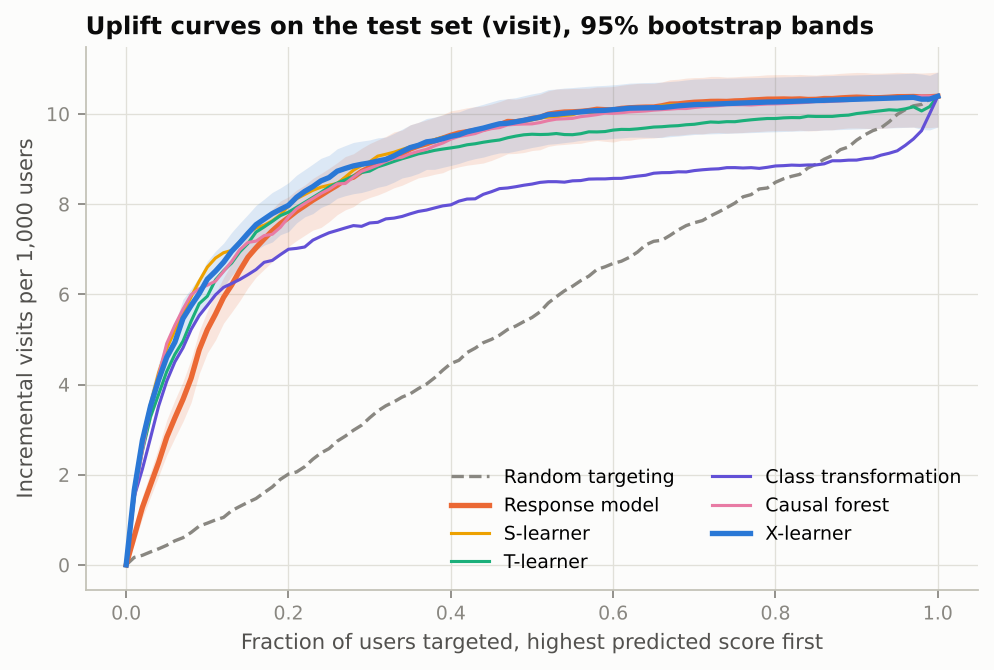
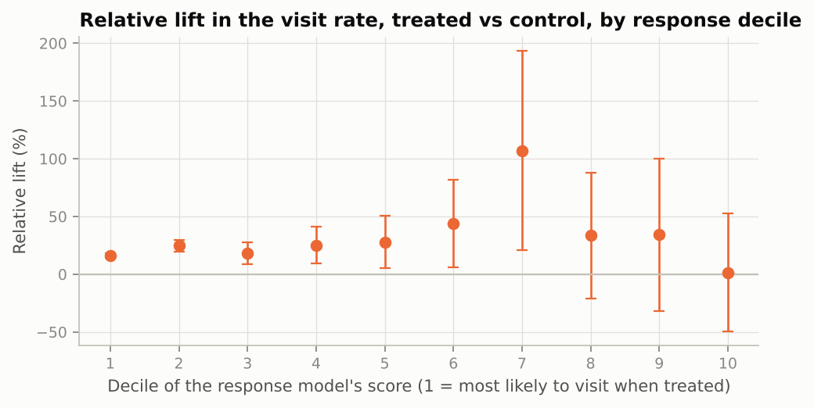

# Uplift Modelling on the Criteo Ad Trial

Showing an ad to someone who was going to buy anyway is wasted money. What
matters is the uplift: how much the ad changes a person's chance of
converting. In this project I estimate uplift for each user in Criteo's
randomised advertising trial (13,979,592 users), check the models on users
they never saw, and turn the best ranking into a targeting rule with an
explicit cost per user and value per conversion.

The main results (money and model comparisons are on the 2,797,207 held-out
test users):

- Across the whole trial, the ad raised conversion from 0.194%
  to 0.309%, i.e. 1.15 extra conversions per 1,000
  users (95% CI [1.08, 1.22]). After adjusting for the way the trial
  was pooled (see below) the effect is about 13% smaller.
- At $0.005 per user and $40 per conversion, showing the ad to everyone
  earns $42,166 per million users. Targeting only the
  56% most likely converters earns $867 more
  (95% CI $357 to $1,463) and saves $2,205 in ad spend.
- At $0.050 per user, just above the $0.047 break-even,
  showing the ad to everyone loses $2,834 per million
  users, while targeting the top 14% with a causal forest
  earns $30,422 (95% CI $25,062 to $35,021).
- For visits, the best uplift model ranked users 6% better than
  a plain "who will visit" model. For conversions no uplift model beat it.

<table><tr>
<td></td>
<td></td>
</tr></table>

## Data

The [Criteo Uplift Prediction Dataset](https://huggingface.co/datasets/criteo/criteo-uplift)
v2.1 (Diemert et al., 2018) has one row per user from incrementality tests,
where a random group was held out from advertising: 11,882,655 treated and
2,096,937 control users, 12 anonymised features, and whether each user
visited the site or converted. `scripts/01_build_db.py` downloads it, checks
its SHA-256 and loads it into DuckDB. All of the exploration is plain SQL in
`sql/`.

Three things came out of the SQL that changed how I set up the rest:

- The file is not shuffled. It is 13 long blocks of all-treated or
  all-control users with very different visit rates
  (`sql/11_treatment_runs.sql`), so splitting by row position would be wrong.
  The split uses a hash instead.
- 2,811,714 rows share an exact feature vector with another row
  (12,353,333 distinct vectors). I hash the feature vector rather than the
  row, so identical rows never end up in both training and test. Split sizes:
  8,386,079 train, 2,796,306 validation, 2,797,207 test.
- `exposure` is recorded after treatment, so it is not used as a feature.


## Checking the randomisation

| Check | Result |
|---|---|
| Largest standardised mean difference between groups | 0.049 (0.1 is the usual limit) |
| Held-out AUC of a classifier predicting treatment from the features | 0.5077, 95% CI [0.5054, 0.5098] |
| Same AUC with shuffled treatment labels (5 runs) | 0.4989 to 0.5011 |
| Predicted chance of treatment, 1st to 99th percentile | 0.82 to 0.90 |

The groups are well balanced, but treatment is slightly predictable from the
features, well outside what shuffled labels give. That fits the block
structure: the file pools several tests that treated different shares of
users, and the features carry a little information about which test a user
came from. I compared the plain difference in means with a cross-fitted
doubly robust (AIPW) estimate, which corrects for this:

| Effect per 1,000 users (train + validation) | Difference in means | AIPW |
|---|---|---|
| Conversion | 1.15 [1.07, 1.22] | 1.00 [0.93, 1.08] |
| Visit | 10.33 [10.01, 10.65] | 7.49 [7.21, 7.78] |

The effect on the whole trial from `sql/06_ate.sql` is 1.15
extra conversions per 1,000 users (Wald CI [1.08, 1.22], grouped
bootstrap [1.08, 1.23]), a 59% relative
lift, and 10.34 extra visits per 1,000 ([10.06, 10.63]).

## Models

All models use LightGBM with early stopping on the validation split
(`src/uplift/learners.py`):

- a response model, P(convert | treated), as the baseline
- S-learner: one model with treatment as a feature
- T-learner: separate models for treated and control users
- X-learner: imputes each user's effect from the other group's model, then
  regresses on it
- class transformation, with the groups reweighted for the 85/15 split
- causal forest (econml `CausalForestDML`) on 1,000,000 training users,
  using the known treatment probability

The model used for decisions is picked on the validation split by Qini
coefficient. The test split is scored once at the end.

To compare rankings I use uplift and Qini curves: sort users by predicted
uplift and measure how many extra conversions the top x% would bring. The
Qini coefficient is the area between the model's curve and random targeting.
Intervals come from a paired bootstrap (300 resamples) that keeps rows
with identical features together.

## Results

Qini coefficient x 1,000 on the test set, with 95% bootstrap intervals. "vs
response" is the paired difference from the response model.

| Ranking | Qini, conversion | Qini, visit | vs response, conversion | vs response, visit | IPW Qini, conv. | IPW Qini, visit |
|---|---|---|---|---|---|---|
| Response model (who converts / visits) | 0.41 [0.34, 0.46] | 3.07 [2.82, 3.25] | baseline | baseline | 0.23 | 1.58 |
| S-learner | 0.40 [0.33, 0.45] | 3.27 [3.05, 3.47] | -0.01 [-0.03, 0.01] | +0.20 [0.09, 0.33] | 0.22 | 1.65 |
| T-learner | 0.24 [0.18, 0.30] | 3.00 [2.75, 3.23] | -0.16 [-0.21, -0.11] | -0.06 [-0.27, 0.17] | 0.13 | 1.45 |
| X-learner | 0.35 [0.29, 0.41] | 3.27 [3.04, 3.48] | -0.06 [-0.09, -0.03] | +0.20 [0.04, 0.36] | 0.19 | 1.61 |
| Class transformation | -0.17 [-0.22, -0.11] | 2.20 [1.98, 2.38] | -0.58 [-0.64, -0.50] | -0.87 [-1.02, -0.72] | -0.08 | 0.80 |
| Causal forest | 0.39 [0.33, 0.44] | 3.20 [2.96, 3.38] | -0.02 [-0.03, -0.01] | +0.13 [0.05, 0.21] | 0.22 | 1.65 |
| Random targeting | -0.01 [-0.05, 0.03] | 0.13 [-0.02, 0.28] | -0.42 [-0.48, -0.35] | -2.94 [-3.17, -2.66] | -0.01 | 0.08 |

For visits, the X-learner (chosen on validation) beats the
response model by +0.20 [0.04, 0.36]. The users
the response model ranks highest are mostly people who visit anyway: for
them the ad raises the visit rate by only 16%, compared
with 24% for everyone else.

For conversions it goes the other way. The response model is the best
ranking on test and the causal forest trails it by
0.02 [0.01, 0.03]. Only
0.29% of users convert, and almost all of the extra conversions come
from the response model's top decile (8.2 per
1,000 users, against at most 0.9 in any
other decile). When the people who might convert and the people the ad can
persuade are the same small group, ranking by "who converts" works just as
well, and estimating the difference of two tiny probabilities only adds noise.

Class transformation is the weakest model and is worse than random on
conversions. It assumes the chance of treatment does not depend on the
features, which is not quite true here, and with so few conversions its
target mostly encodes treatment itself. The lowest-scored conversion decile
is 86.9% treated against 85.0% overall, so the
model has partly learned who was treated.

Re-weighting the test users by the inverse of their estimated treatment
probability shrinks all the Qini values (consistent with the smaller AIPW
effect) but keeps the models in the same order.

<table><tr>
<td></td>
<td></td>
</tr></table>

## From scores to a targeting decision

Profit relative to showing the ad to nobody is
`value x extra conversions - cost x users targeted`, measured on the
randomised test users. The cut-off is chosen on the validation split and
then applied to test unchanged. Picking it on the test curve would report
the best point of a noisy curve and overstate the result. Figures are per
million users.

| Policy | $0.005 per user | $0.050 per user |
|---|---|---|
| Nobody | $0 | $0 |
| Everyone | $42,166 | -$2,834 |
| Response model, cut-off from validation | $43,033 ($37,166 to $48,456), 56% targeted | $29,585 ($23,547 to $34,914), 15% targeted |
| Causal forest, cut-off from validation | $41,779 ($35,850 to $46,730), 65% targeted | $30,422 ($25,062 to $35,021), 14% targeted |

At $0.005 per user, showing the ad to everyone is already profitable
because the break-even cost is $0.047. Targeting the top
56% by the response model keeps 97%
of the extra conversions, saves $2,205 and earns
$867 more ($357 to $1,463). The causal forest
policy is not clearly different from showing the ad to everyone
(-$1,179 to $379). Once the cost passes break-even, showing the ad to
everyone loses money and the ranking is what makes the campaign profitable.

The heatmap at the top varies cost and value from 0.1x to 10x of the base
case. Targeting helps most when the cost per user is close to value x effect.

`streamlit run app/streamlit_app.py` opens a small planner: enter the number
of users, the cost, the value and an optional budget, and it shows how many
users to target, the expected profit with a 90% band, and the feature profile
of each decile.

## Limitations

- The features are anonymised, so the model cannot be explained in business
  terms.
- Criteo sub-sampled the data for privacy, so absolute rates and dollar
  figures are only illustrative. The ranking and the decision method are what
  carry over.
- The pooled file is not perfectly randomised. The model comparison holds
  up under re-weighting, but the AIPW effect is 13%
  smaller for conversions and 27% smaller for visits. The
  profit figures use the plain difference within each targeted group, so
  they are probably optimistic by a similar amount.
- Treatment means eligible for the ad, not necessarily shown it
  (`exposure`). Costs are charged per targeted user.
- The costs and values are assumptions; the sensitivity grid shows where the
  conclusions change.

## Reproducing

```bash
python -m venv .venv && source .venv/bin/activate
make install
make all      # download, DuckDB, SQL checks, training (about 35 min on 4 cores), evaluation, profit, README
make test     # tests on a 20,000-row real sample in tests/data
make app
```

Each step writes `results/*.json` and `figures/`. This README is generated
from those files by `scripts/render_readme.py`, and CI fails if it falls out
of date. Seeds are fixed in `src/uplift/config.py` and the dependencies are
pinned.

## Data source and licence

Criteo AI Lab, *Criteo Uplift Prediction Dataset* v2.1, CC BY-NC-SA 4.0.
Diemert, Betlei, Renaudin and Amini, "A Large Scale Benchmark for Uplift
Modeling", AdKDD 2018. The 20,000-row sample in `tests/data` is shared under
the same licence.
