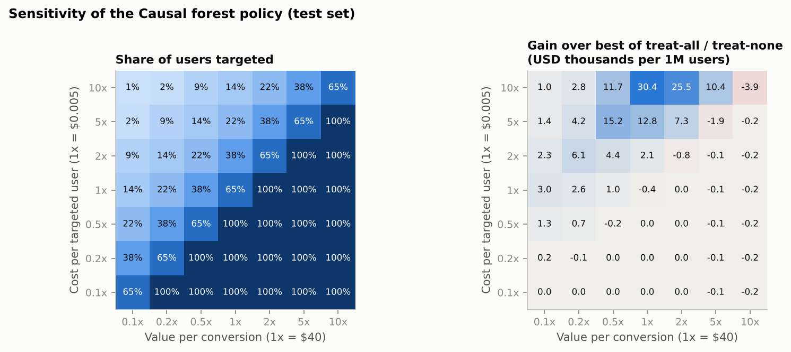
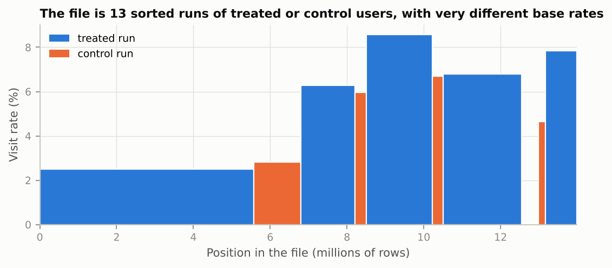
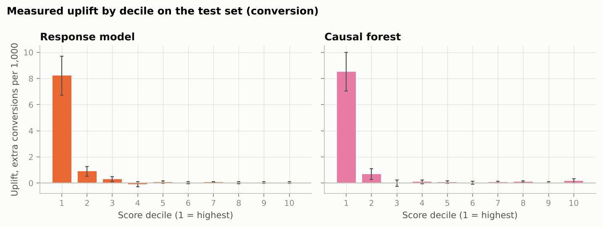

# Uplift Modelling: Who Should See the Ad?

Which users should an advertiser show an ad to, so that incremental profit
is as large as possible? Estimated on the Criteo randomised trial
(13,979,592 users), evaluated once on 2,797,207 held-out users:

- **Effect of the ad:** conversion rises from 0.194% to
  0.309%, +1.15 conversions per 1,000 users
  (95% CI [1.08, 1.22]). A doubly robust estimate that corrects for
  the trial pooling several tests is 13% smaller.
- **Cheap campaign** ($0.005 per targeted user, $40 per conversion):
  treating everyone earns $42,166 per million users. Targeting the
  56% most likely converters earns $867 more
  (95% CI $357 to $1,463) and cuts ad spend by $2,205.
- **Expensive campaign** ($0.050 per user, just above the
  $0.047 break-even): treating everyone loses
  $2,834 per million users; targeting the top
  14% by a causal forest earns **$30,422**
  (95% CI $25,062 to $35,021).
- **Uplift vs "who converts":** for visits, the best uplift model ranks users
  6% better (Qini) than a response model, a significant gain;
  for conversions, which are rarer, the response model is as good as any
  uplift model, and the README explains why.

<table><tr>
<td></td>
<td></td>
</tr></table>

## Problem

An advertiser pays for every user it shows an ad to, but only earns from the
users the ad *changes*: people who convert because of it. Users who would
convert anyway, or never, are wasted spend. The quantity to rank users by is
the individual treatment effect (uplift), not the probability of converting.
This project estimates uplift with five model families on a large randomised
trial, evaluates them honestly on held-out users, and turns the rankings into
a targeting decision with an explicit cost and value.

## Data

The Criteo Uplift Prediction Dataset v2.1 (Diemert et al., 2018): one row per
user from incrementality tests in which a random part of the population was
held out from advertising. 11,882,655 treated and 2,096,937 control
users, 12 anonymised features, `treatment`, `visit`, `conversion` and
`exposure`. The file is downloaded from the official Hugging Face mirror and
verified against its SHA-256 (`scripts/01_build_db.py`), then loaded into
DuckDB; all exploration is SQL in `sql/`.

What the SQL exploration found, and what it changed:

- **The file is sorted.** It is 13 long runs of all-treated or
  all-control users with very different base rates (`sql/11_treatment_runs.sql`).
  A split by position would be meaningless, so the split is a hash.
- **2,811,714 rows share an exact feature vector with another row** (only
  12,353,333 distinct vectors). The split hashes the feature vector, not
  the row, so identical rows never sit on both sides: 8,386,079 train,
  2,796,306 validation, 2,797,207 test users.
- **`exposure` is recorded after treatment** and is never used as a feature.



## Is it really randomised?

| Check | Result |
|---|---|
| Covariate balance, largest standardised mean difference | 0.049 (threshold 0.1) |
| Held-out AUC of a classifier predicting treatment from the features | 0.5077, 95% CI [0.5054, 0.5098] |
| Same AUC after shuffling the treatment labels (5 permutations) | 0.4989 to 0.5011 |
| Predicted treatment probability, 1st to 99th percentile | 0.82 to 0.90 |

Balance is excellent, but treatment is very slightly predictable: the AUC is
small and far outside the permutation null. That fits the run structure
above: the file pools several tests whose treatment shares differ, so the
features carry a little information about which test, and so about the
chance of treatment. Treatment is random *within* each test, not perfectly
across the pooled file. Two consequences are checked rather than assumed:

| Effect per 1,000 users (train + validation) | Difference in means | Cross-fitted AIPW |
|---|---|---|
| Conversion | 1.15 [1.07, 1.22] | 1.00 [0.93, 1.08] |
| Visit | 10.33 [10.01, 10.65] | 7.49 [7.21, 7.78] |

The doubly robust estimate (`src/uplift/causal.py`) adjusts for the
predictable part of treatment. The test-set model comparison is also
repeated with inverse-propensity weights (last two columns of the results
table). The headline ATE on the whole trial, from `sql/06_ate.sql`, is
1.15 extra conversions per 1,000 users (Wald CI
[1.08, 1.22]; grouped bootstrap [1.08, 1.23]), a
relative lift of 59%, and 10.34 extra visits per
1,000 ([10.06, 10.63]).

## Method

| Model | Idea |
|---|---|
| Response model (baseline) | P(outcome \| x, treated): "who converts" |
| S-learner | One model of y on (x, t); uplift = f(x, 1) - f(x, 0) |
| T-learner | Separate models for treated and control users |
| X-learner | Impute individual effects from the other arm's model, regress them, combine with the propensity |
| Class transformation | One classifier on z = 1 for treated converters and control non-converters, arms reweighted for the 85/15 split |
| Causal forest | econml `CausalForestDML` with the design propensity, fitted on 1,000,000 training users |

All base learners are LightGBM with early stopping on the validation split
(`src/uplift/learners.py`). The model used for decisions is chosen on
validation only (largest Qini coefficient); the test split is scored once.

**Metrics** (`src/uplift/metrics.py`). Sort users by predicted uplift. The
uplift curve gives, for each targeted fraction, the extra outcomes per user
of the whole population; the Qini coefficient is the area between the Qini
curve and random targeting (0 = no better than random). 95% intervals come
from a paired Poisson bootstrap (300 replicates) that resamples
groups of identical feature vectors together.

## Results

Test set, Qini coefficient x 1,000 with 95% bootstrap intervals; "vs
response" is the paired difference from the response model.

| Ranking | Qini, conversion | Qini, visit | vs response, conversion | vs response, visit | IPW Qini, conv. | IPW Qini, visit |
|---|---|---|---|---|---|---|
| Response model (who converts / visits) | 0.41 [0.34, 0.46] | 3.07 [2.82, 3.25] | baseline | baseline | 0.23 | 1.58 |
| S-learner | 0.40 [0.33, 0.45] | 3.27 [3.05, 3.47] | -0.01 [-0.03, 0.01] | +0.20 [0.09, 0.33] | 0.22 | 1.65 |
| T-learner | 0.24 [0.18, 0.30] | 3.00 [2.75, 3.23] | -0.16 [-0.21, -0.11] | -0.06 [-0.27, 0.17] | 0.13 | 1.45 |
| X-learner | 0.35 [0.29, 0.41] | 3.27 [3.04, 3.48] | -0.06 [-0.09, -0.03] | +0.20 [0.04, 0.36] | 0.19 | 1.61 |
| Class transformation | -0.17 [-0.22, -0.11] | 2.20 [1.98, 2.38] | -0.58 [-0.64, -0.50] | -0.87 [-1.02, -0.72] | -0.08 | 0.80 |
| Causal forest | 0.39 [0.33, 0.44] | 3.20 [2.96, 3.38] | -0.02 [-0.03, -0.01] | +0.13 [0.05, 0.21] | 0.22 | 1.65 |
| Random targeting | -0.01 [-0.05, 0.03] | 0.13 [-0.02, 0.28] | -0.42 [-0.48, -0.35] | -2.94 [-3.17, -2.66] | -0.01 | 0.08 |

**Visits: uplift is not the same as response.** The X-learner
(chosen on validation) beats the response model by
+0.20 [0.04, 0.36], 6% of the
response model's Qini. The reason shows in the data: among the users the
response model ranks highest, people who visit anyway, the ad raises the visit
rate by only 16%, against 24% for
everyone else. Those "sure things" are where the response model wastes
impressions.

**Conversions: here they nearly coincide.** The response model is the best
ranking on test; the causal forest chosen on validation trails it by
0.02 [0.01, 0.03], a small but
significant gap. Conversions are so
rare (0.29% of users) that almost all the incremental ones come from the small group of
users who might convert at all: the response model's top decile gains
8.2 conversions per 1,000 users, and no other
decile more than 0.9. Finding likely converters
and finding persuadable ones is then the same task, and estimating a
difference of two tiny probabilities only adds noise.

**Class transformation is the weakest model** on both outcomes, and on
conversion it is worse than random. Its reweighting assumes the chance of
treatment does not depend on x; in this pooled file it does slightly, and
with rare outcomes the transformed label mostly encodes treatment itself, so
the classifier partly learns the propensity. The test set shows it: the
decile it scores lowest for conversion is 86.9% treated,
against 85.0% overall.

**Robustness.** Under inverse-propensity weighting all Qini values shrink,
consistent with the AIPW estimate of a smaller effect, but the ordering of
the models is the same.

<table><tr>
<td></td>
<td></td>
</tr></table>

## Business impact

Profit of targeting a set of users, relative to targeting nobody, is
`value x incremental conversions - cost x users targeted`, measured on the
randomised test users. The targeting cut-off is chosen on validation and
applied unchanged to test: picking it on the test curve itself would report
the best point of a noisy curve. Figures are per million users.

| Policy | Base case: $0.005 per user | Expensive: $0.050 per user |
|---|---|---|
| Treat nobody | $0 | $0 |
| Treat everyone | $42,166 | -$2,834 |
| Response model, cut-off from validation | $43,033 ($37,166 to $48,456), 56% targeted | $29,585 ($23,547 to $34,914), 15% targeted |
| Causal forest, cut-off from validation | $41,779 ($35,850 to $46,730), 65% targeted | $30,422 ($25,062 to $35,021), 14% targeted |

- **Base case.** Treating everyone is profitable because the break-even cost
  is $0.047 per user, far above $0.005. Targeting the top
  56% by the response model keeps 97%
  of the incremental conversions, saves $2,205 of ad spend
  and earns $867 more than treating everyone (95% CI
  $357 to $1,463). The causal forest policy is not significantly
  different from treating everyone (-$1,179 to $379).
- **Expensive campaign.** Above break-even, treating everyone loses money and
  the decision rests entirely on the ranking: the causal forest targets
  14% of users and earns $30,422.
- **Sensitivity** (heatmap above, `results/profit.json`): cost and value are
  each varied from 0.1x to 10x. Targeting adds the most when the cost per user
  is close to value x ATE; when value dominates, treat everyone; when cost
  dominates, target a few per cent or nobody.

An interactive version: `streamlit run app/streamlit_app.py` lets you set the
reachable population, cost, value and an optional budget, and shows the
best share to target, the expected incremental profit with a 90% band, and
the feature profile of each decile.

## Limitations

- Features are anonymised random projections, so the model cannot be
  explained in business terms; the app shows feature profiles only.
- The data are sub-sampled non-uniformly by Criteo for privacy, so absolute
  rates and money are illustrative; the ranking and the decision logic are
  what transfer.
- The pooled file is not perfectly randomised (see above). Model comparisons
  survive inverse-propensity weighting, but the doubly robust effect is
  13% smaller for conversions and
  27% smaller for visits than the plain difference in
  means. The profit figures use the plain difference within each targeted
  segment, so they are likely optimistic by a similar proportion.
- Treatment is intention to treat: a treated user was eligible, not
  necessarily shown the ad (`exposure`). Costs are charged per targeted user.
- Costs and values are assumptions; the sensitivity analysis shows where
  the conclusions change.

## Reproduce

```bash
python -m venv .venv && source .venv/bin/activate
make install
make all      # download + DuckDB, SQL exploration, training (~35 min on 4 cores), test evaluation, profit, README
make test     # pytest on a 20,000-row real sample in tests/data
make app
```

Each stage writes `results/*.json` and `figures/`; this README is generated
from those files by `scripts/render_readme.py`, and CI checks that it matches.
Seeds are fixed in `src/uplift/config.py` and dependencies are pinned.

## Data source and licence

Criteo AI Lab, *Criteo Uplift Prediction Dataset* v2.1, CC BY-NC-SA 4.0.
Diemert, Betlei, Renaudin and Amini, "A Large Scale Benchmark for Uplift
Modeling", AdKDD 2018. The 20,000-row sample in `tests/data` is
redistributed under the same licence.
